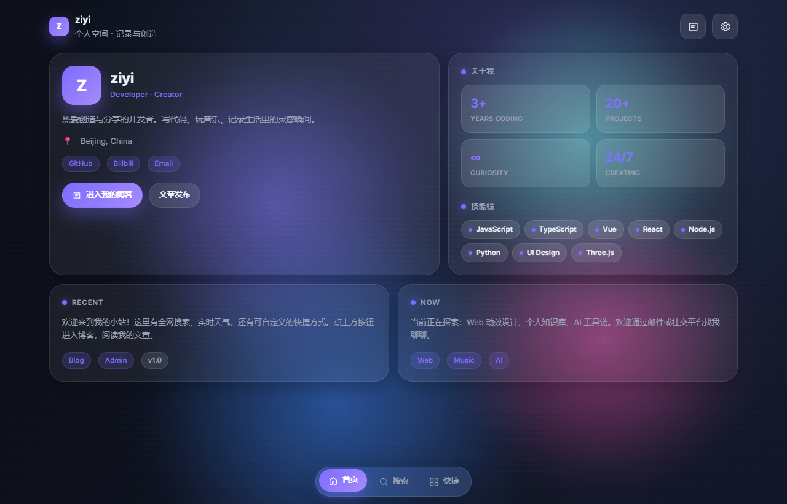
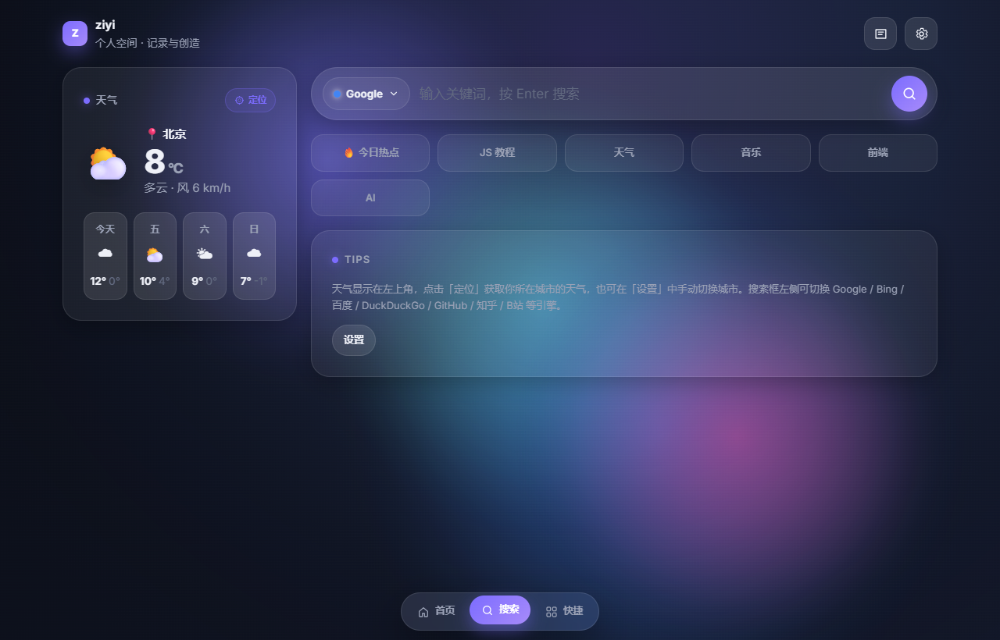
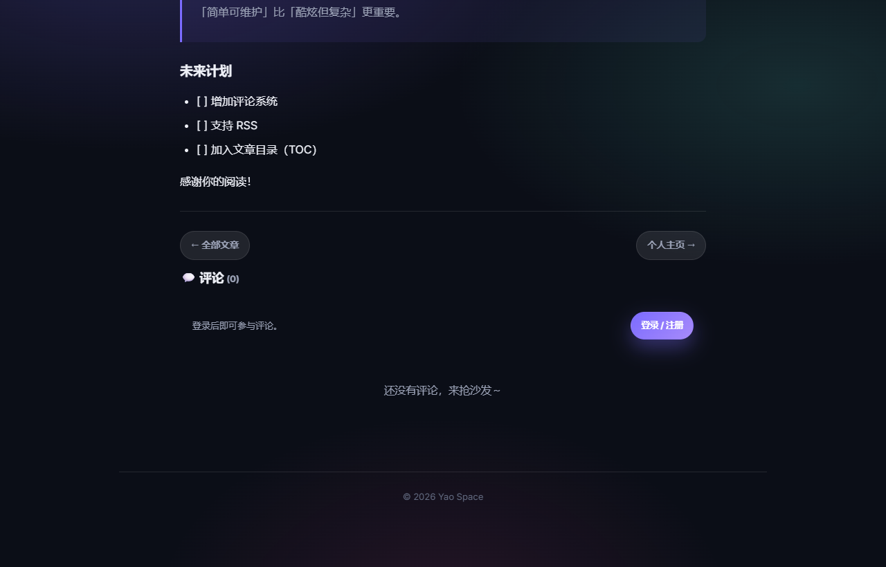
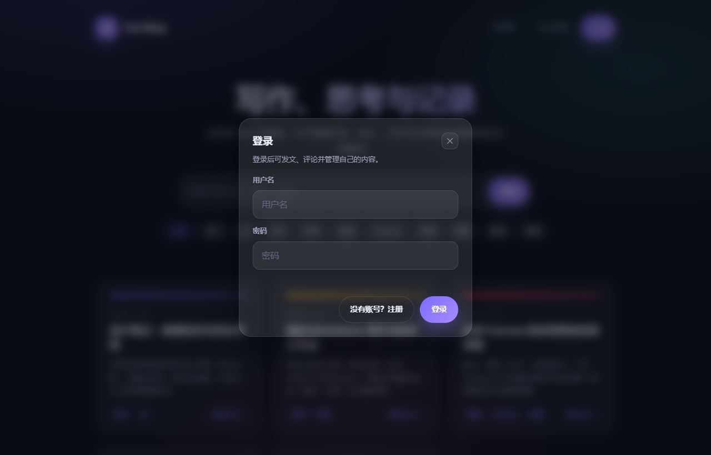
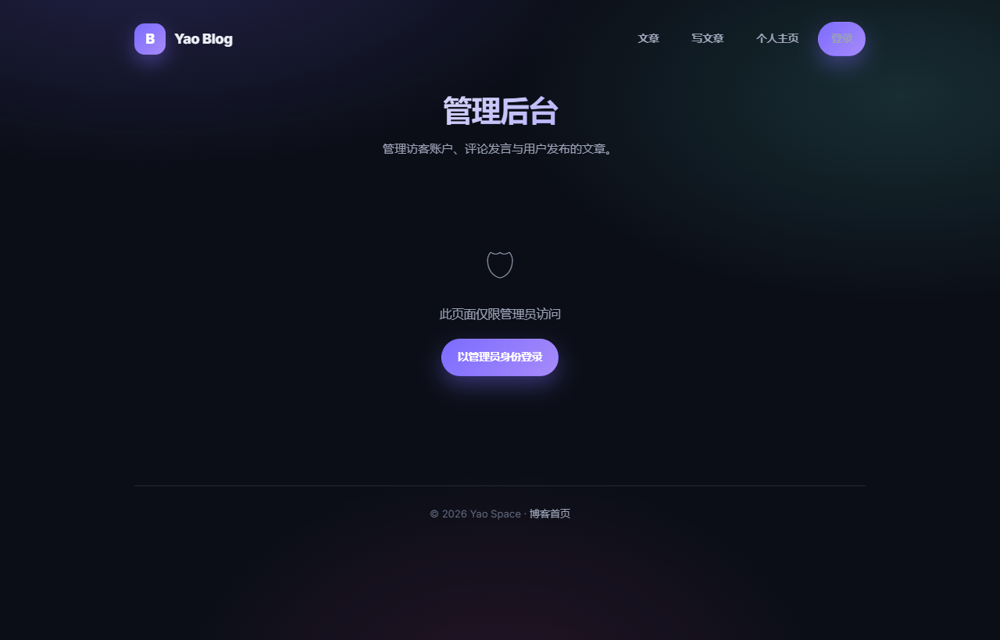
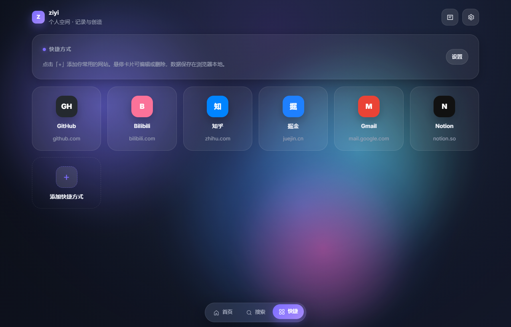

<div align="center">

# ziyi · 个人主页 + 博客

**一个零依赖、无需构建的个人主页 / 博客 / 文章发布站**

把动态背景、天气、搜索引擎聚合、快捷方式、Markdown 博客、账号评论系统
全部装进纯 HTML / CSS / 原生 JS —— 双击即跑，上传即部署。

<br>


</div>

---

## ✨ 功能一览

| 模块 | 能力 |
| --- | --- |
| 🏠 **个人主页** | 个人信息卡 / 技能栈 / 博客入口，底部胶囊导航三页切换 |
| 🌌 **动态背景** | 极光、星河、粒子、流体渐变、自定义图片，速度可调，明暗主题自适配 |
| 🔍 **全网搜索** | Google / Bing / 百度 / DuckDuckGo / GitHub / 知乎 / B站 一键切换，高斯模糊玻璃下拉 |
| 🌦 **实时天气** | Open-Meteo 免费接口，城市手动切换 + 浏览器一键定位 |
| ⚡ **快捷方式** | 常用网站九宫格，自由增删改，本地记忆 |
| 🎨 **设置面板** | 8 种主题色、深浅色、中英文、背景与城市，全部即时生效 |
| 📝 **Markdown 博客** | 文章卡片预览、标签筛选、全文搜索高亮、代码块 / 表格渲染 |
| ✍️ **个人发文** | 登录后即可写作，Markdown 编辑 + 实时预览 + 我的文章管理 |
| 💬 **评论系统** | 文章下留言讨论，作者可删自己的，管理员可删任意发言 |
| 👤 **账号体系** | 注册 / 登录，密码加盐哈希存储；管理员 / 普通访客双角色 |
| 🛡 **管理后台** | 账户管理（封禁 / 升降级 / 删除）、发言管理、文章管理 |
| 📦 **发布站** | 站主专用：写文章、预览、导出 `posts.json` / `.md`，一键上线 |

## 📸 界面预览

| 个人主页 | 搜索页 |
| :---: | :---: |
|  |  |

| 博客列表 | 文章 + 评论 |
| :---: | :---: |
|  |  |

| 登录 | 管理后台 |
| :---: | :---: |
|  |  |

<details>
<summary>更多截图：快捷方式 / 设置面板</summary>

| 快捷方式 | 设置面板 |
| :---: | :---: |
|  |  |

</details>

## 🚀 快速开始

**方式一（推荐，零安装）**：双击项目根目录的 **`启动服务.cmd`** ——
基于 Windows 自带 PowerShell 实现，不需要 Python / Node。启动后浏览器打开
http://127.0.0.1:8765/ ，窗口按 `Ctrl+C` 或关闭即停止。

```powershell
# 等价命令行
powershell -NoProfile -ExecutionPolicy Bypass -File .\start-server.ps1
```

**方式二（Python）**

```powershell
python -m http.server 8765 --bind 127.0.0.1
```

**方式三（Node.js）**

```powershell
npx serve -l 8765 .
```

> ⚠️ 请勿直接双击 `index.html` 用 `file://` 打开 —— 文章库 `posts.json`
> 依赖 fetch 加载，会被浏览器拦截。任何静态服务器都可以，端口随意。

## 🗂 项目结构

```
├── index.html              # 个人主页（首页 / 搜索 / 快捷方式）
├── config.js               # 全部配置集中于此，改它即可换人
├── start-server.ps1        # 零依赖本地服务器
├── 启动服务.cmd             # 双击启动
├── css/  js/               # 全局样式 / 动态背景引擎 / 天气 / 搜索 / 设置
├── blog/                   # 个人博客
│   ├── index.html          #   文章列表 + 搜索 + 标签
│   ├── article.html        #   文章详情 + 评论区
│   ├── write.html          #   个人发文（登录后可用）
│   ├── manage.html         #   管理后台（仅管理员）
│   ├── posts/posts.json    #   文章库（维护这一个文件即可）
│   └── js/backend.js       #   账号 / 评论 / 文章本地数据层
├── admin/                  # 站主发布站（导出 posts.json）
└── docs/img/               # README 截图
```

## ⚙️ 配置（config.js）

部署后**只需要改 `config.js` 一个文件**：

| 字段 | 说明 |
| --- | --- |
| `siteName` / `user` | 站点名、姓名、头像、简介、社交链接 |
| `searchEngines` | 搜索引擎列表，自由增删 |
| `defaults` | 默认主题色 / 明暗 / 动态背景 / 语言 |
| `shortcuts` | 快捷方式默认项 |
| `defaultCity` | 天气默认城市 |
| `auth.adminUser / adminPass` | 初始管理员口令（⚠️ 部署后请立刻修改） |
| `apiBase` | 可选后端接口，接上后发布站可直发服务器 |

用户偏好（主题、语言、背景、自定义快捷方式）保存在浏览器 `localStorage`。

## 👤 账号与博客

| 角色 | 权限 |
| --- | --- |
| **管理员** | 管理访客账户（封禁 / 删除 / 升降级）、删除任意评论、删除任意用户文章 |
| **普通访客** | 发表文章、参与评论；管理自己的文章与评论 |

- 初始管理员：`ziyi / ziyi123456`（在 `config.js` 的 `auth` 中修改）
- 密码以 **SHA-256 + 随机盐** 哈希存储，本地不保存任何明文
- 管理后台入口：管理员头像菜单 →「管理后台」

> 纯静态站点的账号数据按浏览器隔离，适合个人使用与演示；
> 正式运营请将 `blog/js/backend.js` 的存储层替换为真实后端 API（哈希逻辑可直接复用）。

## 📝 写文章 / 上线流程

1. 站主在 **`admin/` 发布站** 写文章（或博主在 `blog/write.html` 直接发文）
2. 「预览」确认排版 →「导出 `posts.json`」
3. 覆盖到 `blog/posts/posts.json`，刷新博客页即可

## 🌐 部署

纯静态文件，整体上传即可，无需 Node / Python 常驻。Nginx 参考：

```nginx
server {
    listen 80;
    server_name example.com;
    root /var/www/ziyi-site;
    index index.html;

    location / { try_files $uri $uri/ =404; }

    # 发布新文章立即生效
    location = /blog/posts/posts.json { add_header Cache-Control "no-cache"; }
    location = /config.js             { add_header Cache-Control "no-cache"; }
}
```

同样适配 GitHub Pages、Cloudflare Pages、对象存储静态托管。

## ❓ 常见问题

| 问题 | 处理 |
| --- | --- |
| 文章列表为空 | 用静态服务器打开，不要用 `file://` |
| 天气加载失败 | 需要联网（Open-Meteo 公开接口） |
| 定位无反应 | 允许浏览器位置权限；仅 `127.0.0.1` / `https` 支持 |
| 改了配置没生效 | `Ctrl + F5` 强刷；生产环境对 `config.js` 设 `no-cache` |
| 忘记管理员口令 | 清除站点 localStorage 后按 `config.js` 的 `auth.adminPass` 重建 |

## 📄 说明

本项目面向个人主页 / 博客场景的**可运行参考实现**，代码可自由学习、改造与使用。
欢迎 Star ⭐ / Fork，提 Issue 讨论想法。
