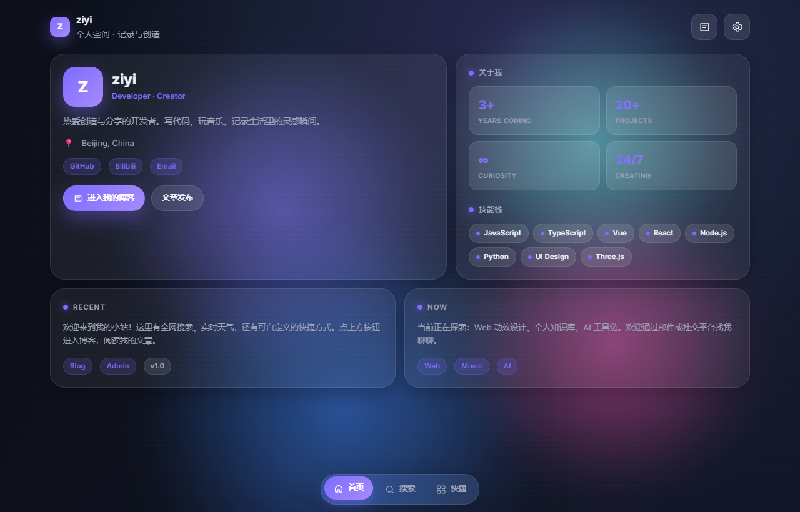
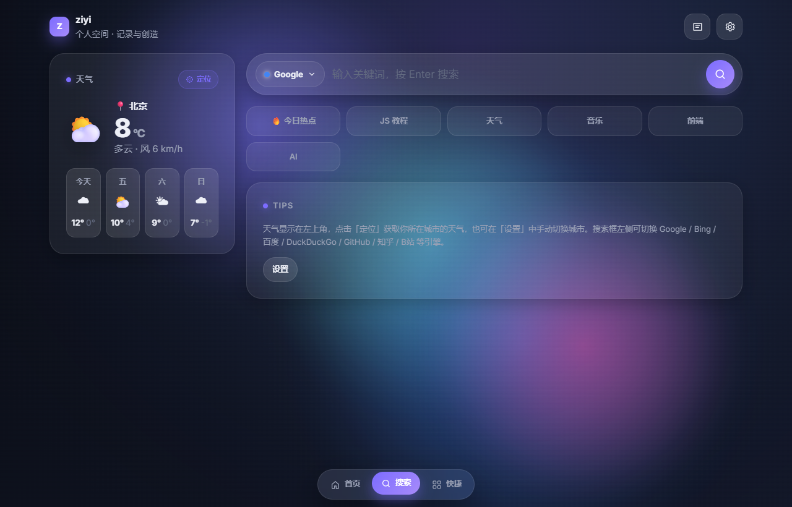
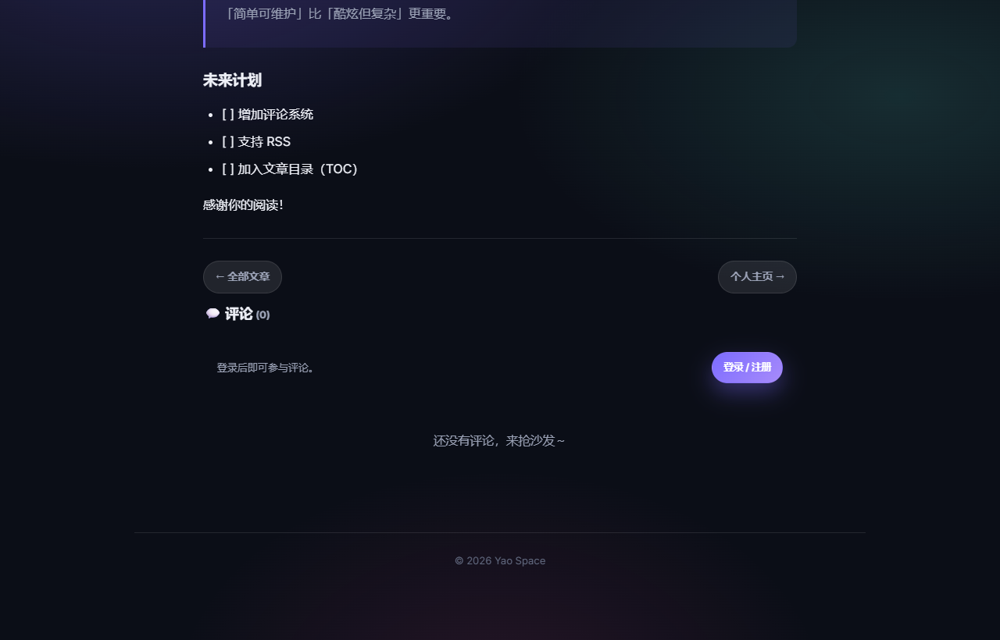

<div align="center">

# ziyi · 个人主页 + 博客（React 版）

**Vite + React 实现，为 Cloudflare Pages 预设部署而生**

同一套功能的 React 重写版：动态背景、天气定位、多引擎搜索、快捷方式、
Markdown 博客、账号评论系统 —— `npm run build` 产出纯静态 `dist/`，拖进 Cloudflare 即上线。

<br>


</div>

---

## ✨ 功能

| 模块 | 能力 |
| --- | --- |
| 🏠 个人主页 | 个人信息卡 / 技能栈 / 底部胶囊导航三页切换 |
| 🌌 动态背景 | 极光、星河、粒子、流体渐变、自定义图片，明暗主题自适配 |
| 🔍 全网搜索 | Google / Bing / 百度 / DuckDuckGo / GitHub / 知乎 / B站 一键切换 |
| 🌦 实时天气 | Open-Meteo 免费接口，城市切换 + 浏览器一键定位 |
| ⚡ 快捷方式 | 九宫格自由增删改，本地记忆 |
| 🎨 设置面板 | 8 种主题色、深浅色、中英文、背景与城市即时生效 |
| 📝 Markdown 博客 | 文章卡片、标签筛选、全文搜索高亮、代码块 / 表格 |
| ✍️ 个人发文 | 登录后写作 + 预览 + 我的文章管理 |
| 💬 评论 | 文章下留言，作者 / 管理员可删 |
| 👤 账号体系 | 注册登录，密码加盐哈希；管理员 / 访客双角色 |
| 🛡 管理后台 | 账户、发言、文章三块管理 |
| 📦 发布站 | 文章编辑、预览、导出 `posts.json` |

## 📸 界面预览

| 个人主页 | 搜索页 |
| :---: | :---: |
|  |  |

| 博客 | 文章 + 评论 |
| :---: | :---: |
|  |  |

## 🚀 本地开发

需要 Node.js 18+。

```bash
npm install        # 安装依赖
npm run dev        # 开发调试  http://127.0.0.1:5173
npm run build      # 生产构建  产出 dist/
npm run preview    # 本地预览构建产物  http://127.0.0.1:4173
```

## ☁️ 部署到 Cloudflare Pages

### 方式一：Wrangler CLI（最快）

```bash
npm install -g wrangler   # 或用 npx wrangler ...
wrangler login            # 浏览器授权 Cloudflare
npm run deploy            # = npm run build && wrangler pages deploy dist
```

### 方式二：Dashboard 连接 Git（推荐长期使用）

1. 把本目录推到 GitHub / GitLab
2. Cloudflare Dashboard → **Workers & Pages** → **Create** → **Pages** → **Connect to Git**
3. 选择仓库后，框架预设选 **React (Vite)**，构建参数确认为：

   | 设置 | 值 |
   | --- | --- |
   | Framework preset | **React (Vite)** |
   | Build command | `npm run build` |
   | Build output directory | `dist` |
   | Node.js 版本 | 18 或更高（Environment variables → `NODE_VERSION`） |

4. 保存并部署，之后每次 `git push` 自动构建发布

### 方式三：直接上传

`npm run build` 后在 Dashboard → Pages → **Upload assets**，把 `dist/` 拖进去即可。

> **SPA 路由**：`public/_redirects` 已包含 `/*  /index.html  200`，
> 构建时自动拷入 `dist/`，`/blog`、`/write` 等路由刷新不会 404。
> 若用方式三上传，请确认 `_redirects` 文件在上传内容里。

## 🗂 项目结构

```
├── index.html              # 入口
├── vite.config.js          # Vite 配置
├── wrangler.toml           # Cloudflare Pages 配置
├── public/_redirects       # SPA 路由回退
└── src/
    ├── config.js           # 全部站点配置（改这里即可换人）
    ├── App.jsx             # 路由与全局状态
    ├── data/posts.json     # 文章库
    ├── styles/             # 全站样式（玻璃拟态设计系统）
    ├── lib/                # 背景引擎 / 天气 / 账号后端 / Markdown / i18n
    ├── components/         # TopBar / 天气 / 搜索 / 快捷方式 / 设置 / 评论 / 登录
    └── pages/              # Home / Blog / Article / Write / Manage / Publish
```

## ⚙️ 配置（src/config.js）

| 字段 | 说明 |
| --- | --- |
| `siteName` / `user` | 站点名、姓名、简介、社交链接 |
| `searchEngines` | 搜索引擎列表 |
| `defaults` | 默认主题色 / 明暗 / 背景 / 语言 |
| `shortcuts` | 快捷方式默认项 |
| `defaultCity` | 天气默认城市 |
| `auth.adminUser / adminPass` | 初始管理员口令（⚠️ 部署后请立刻修改） |

## 👤 账号系统说明

- 初始管理员：`ziyi / ziyi123456`（`src/config.js` 中修改）
- 密码以 **SHA-256 + 随机盐** 哈希存储，不保存明文
- 访客可注册、发文、评论；管理员可在 `/manage` 管理账户 / 发言 / 文章
- 数据存于浏览器 `localStorage`（纯静态演示实现）；
  正式运营请将 `src/lib/backend.js` 的存储层替换为真实后端 API（如 Cloudflare D1 + Workers），
  哈希逻辑可直接复用

## 📄 说明

个人主页 / 博客场景的可运行参考实现，代码可自由学习与改造。欢迎 Star ⭐ / Fork。
